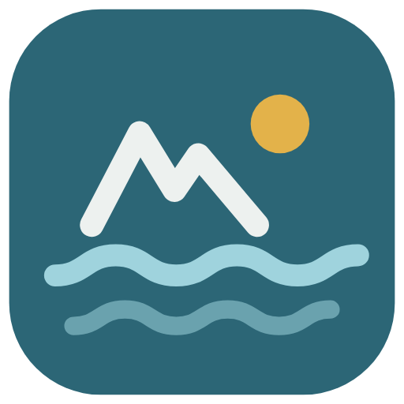
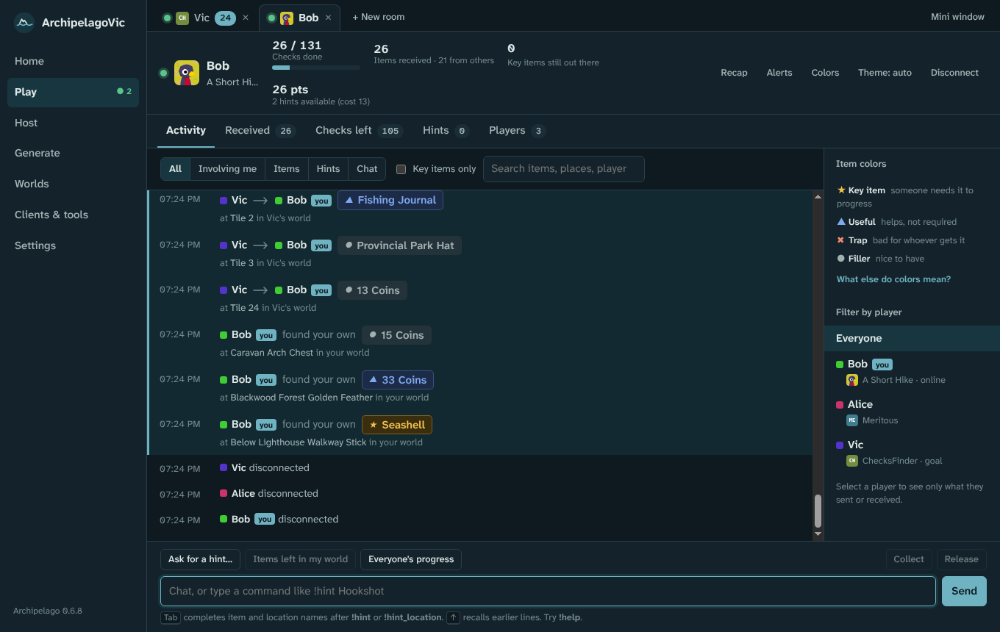
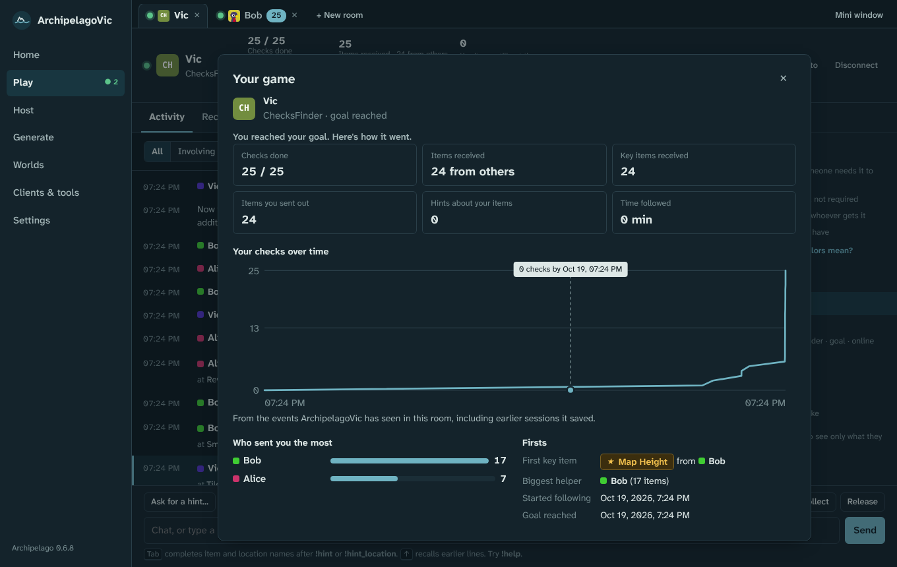
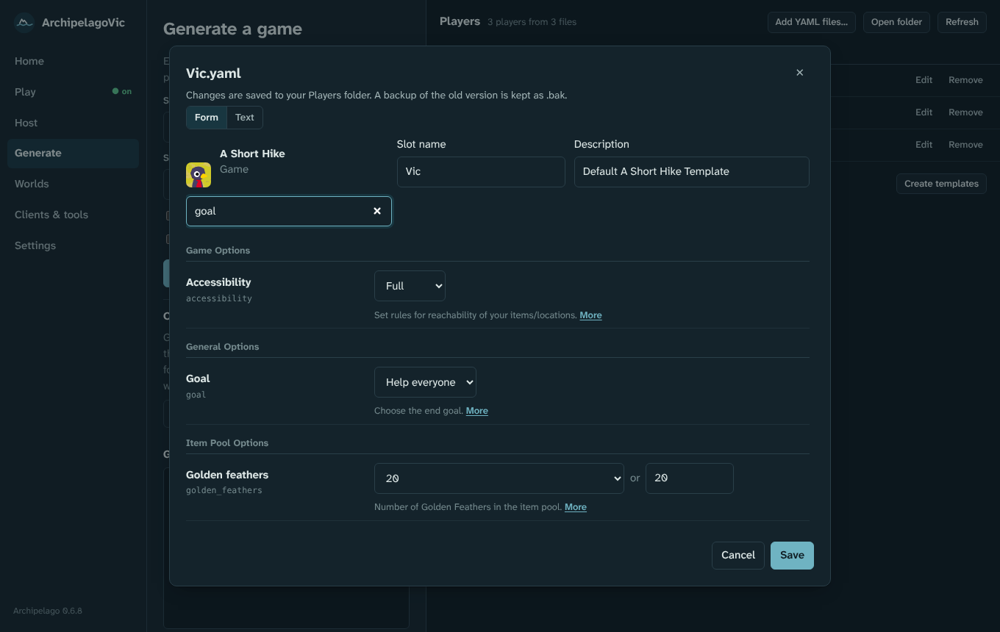
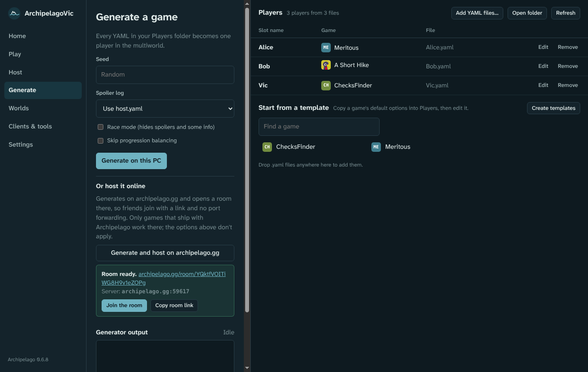
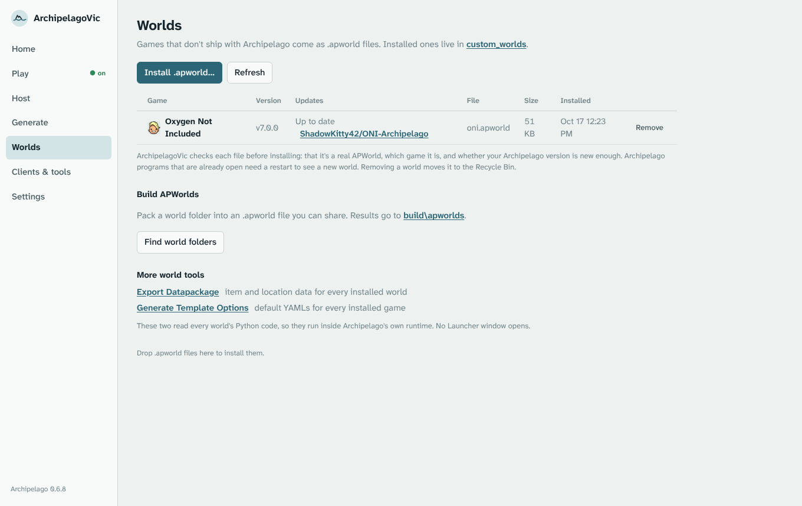
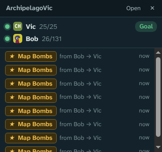

<p align="center">
  
</p>

<h1 align="center">ArchipelagoVic</h1>

<p align="center">
  A friendlier launcher and text client for <a href="https://archipelago.gg">Archipelago</a> multiworld randomizers.<br>
  See who sent what to whom, what's still out there, and everyone's progress, in one window.
</p>

<p align="center">
  
</p>

ArchipelagoVic replaces the official Archipelago Launcher and its text client. It uses the Archipelago install already on your PC (found automatically in `C:\ProgramData\Archipelago`) for the server, the generator and the game clients, so you never need to open the official Launcher.

> Unofficial fan project. Not affiliated with or endorsed by the Archipelago team.

## Contents

- [Features](#features)
- [Install](#install)
- [Using it](#using-it)
- [Screenshots](#screenshots)
- [Building from source](#building-from-source)
- [Troubleshooting](#troubleshooting)
- [Project layout](#project-layout)
- [License](#license)

## Features

**Following a game**
- **Readable activity feed.** Every line says who found what for whom and where ("Vic → Bob · Fishing Journal, at Tile 2 in Vic's world"). Items found in your own world are labelled as yours.
- **Colours that mean something.** ★ gold for key items someone needs to progress, ▲ blue for useful, ✖ red for traps, ● grey for filler. A colour guide sits right next to the feed.
- **Received, Checks left, Hints and Players tabs**, with search, filters by player, and "key items only".
- **"Key items still out there."** Your hinted key items that haven't been found yet, front and centre.
- **Alerts** (sound, flashing taskbar, desktop notification) when a key item arrives or someone hints for something in your world.
- **History survives reconnects.** Everything you've seen in a room is kept and shown again when you rejoin.
- **Quick commands:** Ask for a hint, Items left in my world, Everyone's progress, Collect and Release (with confirmation), plus Tab-completion for item and location names.
- **Game recap.** Checks over time, who sent you the most, your first key item. It opens by itself when you reach your goal.

**Several rooms, and staying out of the way**
- **One tab per room.** Play several games at once, each with its own unread count and ★ waiting items. Open rooms come back the next time you start the app.
- **Mini window** that stays on top of borderless-fullscreen games and shows every room's checks and the latest items you got.
- **Lives in the tray.** Closing the window keeps your rooms connected. You can turn this off in Settings.

**archipelago.gg rooms**
- **Paste a room link** (`https://archipelago.gg/room/…`). ArchipelagoVic wakes the room, finds its port and remembers the link.
- **Live tracker.** In link rooms, the Players tab shows everyone's real progress from the website: checks done, items received, last active.
- **Generate and host on archipelago.gg** in one click: no port forwarding, just send your friends the room link. This only works for games that ship with Archipelago.

**Everything the official Launcher does**
- **Host** a multiworld on your PC with a live server console and quick server commands.
- **Generate** from your Players folder, with spoiler and race options, then host it in one click.
- **Edit player YAMLs in a form**: dropdowns, number boxes, option descriptions and search. Comments are kept, and a raw text view is one click away.
- **Worlds:** install `.apworld` files (it checks the game, the Archipelago version it needs and clashes with built-in worlds), update them from GitHub, remove them, and build `.apworld` files from world folders.
- **Clients & tools:** every game client, tool and adjuster in your install, including ones custom worlds add. Python-only clients start inside Archipelago's own runtime, with no Launcher window.
- **Patch files and `archipelago://` links** open straight into the right client.
- **Update checks** for Archipelago and your custom worlds.
- **Game icons and summaries** (from Steam, SteamGridDB and Wikipedia), light and dark themes.

## Install

### Option 1: installer

Download **`ArchipelagoVic Setup <version>.exe`** from the [Releases page](https://github.com/vicmi96/ArchipelagoVic/releases) and run it. The portable `.exe` from the same page runs without installing.

Windows SmartScreen may warn the first time because the installer isn't code-signed. Choose **More info → Run anyway**.

### Option 2: run from the source

1. Install [Node.js LTS](https://nodejs.org) (once).
2. Download or clone this repository.
3. Double-click **`Start ArchipelagoVic.cmd`**. The first run downloads Electron (about a minute); after that it opens straight away.

### Requirements

- Windows 10 or 11.
- [Archipelago](https://github.com/ArchipelagoMW/Archipelago/releases) 0.6.x installed, for hosting, generating and game clients. Just following a game works without it.

## Using it

| Section | What it's for |
|---|---|
| **Home** | Common tasks, recent rooms, what's running, updates, community links. Drop a patch file, `.apworld` or YAML anywhere on the window. |
| **Play** | The text client, one tab per room. Type a server address (`archipelago.gg:38281`) or paste a room link, enter your slot name, then Connect. |
| **Host** | Runs `ArchipelagoServer.exe` on a generated game. "Join this game" connects you to it. |
| **Generate** | Your Players folder (add, edit, remove, start from a template). "Generate on this PC" or "Generate and host on archipelago.gg". |
| **Worlds** | Install, update, remove and build `.apworld` files. |
| **Clients & tools** | Start any game client or tool from your Archipelago install. |
| **Settings** | Archipelago folder, `host.yaml` (a backup is kept), tray behaviour, `archipelago://` links, game pictures, SteamGridDB key, alerts and theme. |

**Tips**
- Click any game's name or icon for its summary: cover, genre, developer, release date and links. Right-click an icon to use your own picture.
- Games that aren't on Steam (Zelda, Pokémon…) need a free [SteamGridDB API key](https://www.steamgriddb.com/profile/preferences/api) for their icon. Add it under Settings.
- Just want the text client in a browser? Open `ArchipelagoClient.html`. It needs no install, but it can't host, generate, launch anything or use room links.

## Screenshots

| | |
|---|---|
|  |  |
| **Recap** when you reach your goal | **YAML form editor** with option search |
|  |  |
| **Generate and host on archipelago.gg** | **Worlds** with update checks (light theme) |

<p align="center"><br><b>Mini window</b>, always on top</p>

## Building from source

```bat
npm install
npm start
```

**Build the installer:** double-click **`Build installer.cmd`**, or run `npm run dist`. It writes these to `dist\`:
- `ArchipelagoVic Setup <version>.exe` (installer);
- `ArchipelagoVic-<version>-portable.exe` (portable);
- `win-unpacked\` (the unpacked app).

`dist\` and `node_modules\` are in `.gitignore` because they're over GitHub's 100 MB file limit. To share a build, attach the Setup `.exe` to a [GitHub Release](https://docs.github.com/en/repositories/releasing-projects-on-github/managing-releases-in-a-repository) instead.

**Rebuild the browser-only client:** `npm run standalone` regenerates `ArchipelagoClient.html` from `renderer/`.

## Troubleshooting

- **"Windows cannot find node_modules\electron\dist\electron.exe".** npm installed Electron's package but skipped its download. Run `Start ArchipelagoVic.cmd` again; it finishes the download itself. To do it by hand: `node node_modules\electron\install.js`.
- **The Electron download fails.** Check your internet connection and whether antivirus is blocking it, then run the start file again.
- **"Archipelago not found".** Settings → Change folder, then pick the folder that contains `ArchipelagoLauncher.exe`.
- **Can't connect to an archipelago.gg room.** Rooms go to sleep after a while. Paste the room link instead of the address, and ArchipelagoVic wakes the room and finds its new port.
- **Hosting online says a game isn't supported.** archipelago.gg can only generate games that ship with Archipelago. Generate and host games from custom `.apworld` files on your PC.
- **Where's my data?** Settings, saved rooms, history and game pictures are in `%APPDATA%\ArchipelagoVic`.

## Project layout

```
main.js                 Electron main process: runs Archipelago programs, files, tray, updates
preload.js              The fixed set of actions the window may ask the main process for
aplib.js                Zip, APWorld and patch handling; game icons, covers and summaries
components.json         Every Archipelago Launcher component and how ArchipelagoVic runs it
game-art.json           Where each game's picture comes from (Steam app or Wikipedia article)
renderer/
  index.html, launcher.js   Main window: Home, Play tabs, Host, Generate, Worlds, Tools, Settings
  client.html, client.js    One room (the text client); also the browser-only client
  mini.html, mini.js        Always-on-top mini window
  yamlform.js               Form editor for player YAMLs
  styles.css                Shared styles (light and dark)
  icon.png, icon.ico        App icon
tools/build-standalone.js   Builds ArchipelagoClient.html
Changes/                    Timestamped patch notes for every change
docs/screenshots/           Images used in this README
```

## License

[MIT](LICENSE) © 2026 Victória Miranda.

Archipelago is © its contributors and released under the MIT License. Game names, icons and cover art belong to their respective owners and are downloaded to your PC only for display.
